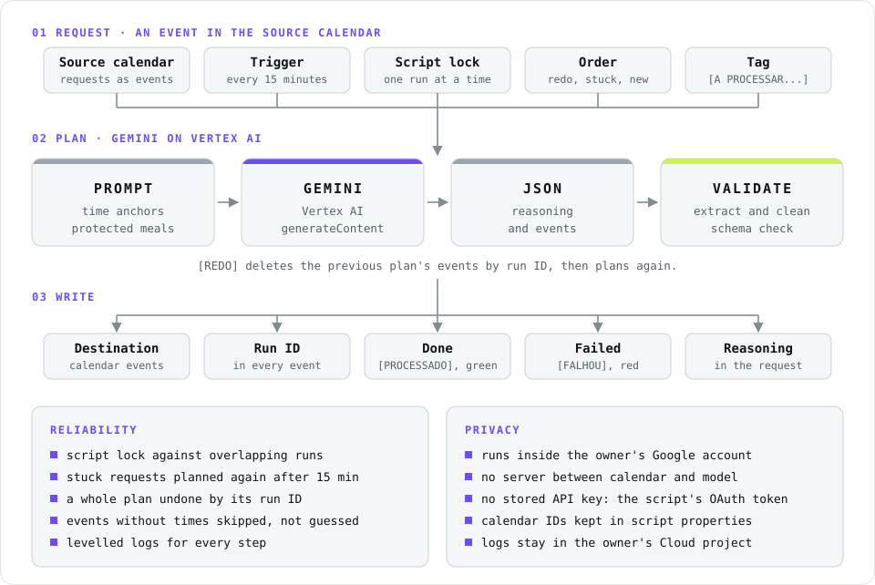
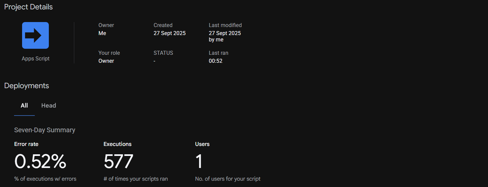
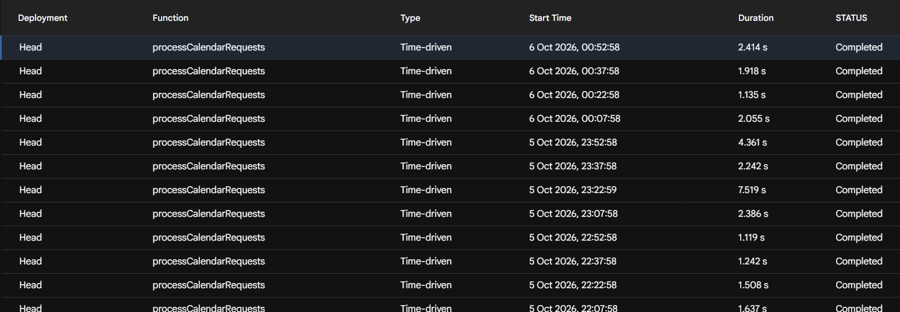

<!-- brand:header:start -->
<h1 align="center">WhiteAiScheduler</h1>

  <b>Calendar requests in, a planned schedule out: Gemini on Vertex AI, from Google Apps Script.</b>

  A working personal tool, triggered every 15 minutes since September 2025. No server and no stored API key: the script calls Vertex AI with its own OAuth token.

  
  
  
  
   
  
  
  
  

  <picture>
    <source media="(prefers-color-scheme: dark)" srcset="docs/assets/whiteaischeduler-architecture-dark.svg">
    
  </picture>

## At a glance

<table>
  <tr><td width="190"><b>What it does</b></td><td>A planning request is written as an event in one calendar: a title such as "Planear o fim de semana" and the tasks in its description. The script asks Gemini for a schedule and writes the planned events into a second calendar.</td></tr>
  <tr><td width="190"><b>How it works</b></td><td>A time-driven trigger checks the source calendar every 15 minutes. The request is tagged while it runs, sent to Vertex AI with a prompt that fixes time anchors, protected meal windows and a JSON-only answer, and every event created carries the run's ID.</td></tr>
  <tr><td width="190"><b>Reliability</b></td><td>A script lock prevents overlapping runs; a request stuck for 15 minutes is planned again; <code>[REDO]</code> deletes the previous plan by its run ID and plans again; every step is logged with a level.</td></tr>
  <tr><td width="190"><b>Where it runs</b></td><td>Google Apps Script, linked to a Google Cloud project with the Vertex AI API enabled. There is no server and no stored API key.</td></tr>
</table>

<table>
  <tr>
    <td align="center"><b>577</b> runs in 7 days</td>
    <td align="center"><b>0.52%</b> error rate over 7 days</td>
    <td align="center"><b>15 min</b> trigger and stuck-run timeout</td>
    <td align="center"><b>1</b> run ID per plan, for redo</td>
    <td align="center"><b>0</b> servers or API keys</td>
  </tr>
</table>

## Tech stack

| Area | Used for |
|---|---|
| **Runtime** | Google Apps Script (V8), time-driven trigger, <code>LockService</code>, <code>PropertiesService</code> for calendar IDs and the Cloud project |
| **AI** | Vertex AI <code>generateContent</code>, Gemini 2.0 Flash (configurable), a prompt with time anchors, protected meal windows, deferral rules and a JSON-only output contract |
| **Calendar** | <code>CalendarApp</code>: a source calendar for requests, a destination calendar for plans, colour-coded request status |
| **Robustness** | JSON extraction and control-character clean-up, a schema check of <code>events</code> and <code>reasoning</code>, run IDs for redo, stuck-run recovery, levelled logs in Cloud Logging |

---
<!-- brand:header:end -->

## Contents

- [At a glance](#at-a-glance)
- [Tech stack](#tech-stack)
- [Features](#features)
- [How a request flows](#how-a-request-flows)
- [Install](#install)
- [Status](#status)

---

## Features

- **Plans from one calendar event.** Create an event in the source calendar, such as "Planear o fim de semana", with the tasks in its description. The next run sends it to Gemini on Vertex AI and writes the plan as events in a second calendar.
- **Rules the plan must keep:**
  - Fixed-time tasks keep their exact time.
  - Lunch (12:30–14:00) and dinner (19:30–21:00) stay free.
  - Afternoon work starts at 14:30.
  - Personal time is protected on the weekend.
- **The reasoning comes back with the plan.** The model's explanation of the schedule is written into the request event, together with the number of events created and the run ID.
- **Request status shows as a tag and a colour on the request event:**

  | Tag | Colour | Meaning |
  |---|---|---|
  | `[A PROCESSAR...]` | orange | the request is being planned |
  | `[PROCESSADO]` | green | the plan was written |
  | `[FALHOU]` | red | planning failed |
- **Redo:** add `[REDO]` to a processed request's title. The next run deletes every event of the previous plan (found by its run ID) and plans again.
- **Recovery:** a request still marked `[A PROCESSAR...]` after 15 minutes is treated as a failed run and planned again.
- **One run at a time:** a script lock stops overlapping runs from planning the same request twice.

## How a request flows

1. A time-driven trigger calls `processCalendarRequests` every 15 minutes.
2. The script reads the source calendar from 30 days back to 2 days ahead, in this order: a `[REDO]` first, then a stuck request, then the newest new request.
3. The request is tagged `[A PROCESSAR...]`. The prompt is built from the request text, its details and its date, and sent to Vertex AI `generateContent`.
4. The answer must be one JSON object with `reasoning` and `events`:
   - The object is extracted from the text and control characters are removed before parsing.
   - Events without a start or end time are skipped.
5. Each event is created in the destination calendar with the run ID in its description. The request is then marked done or failed.

  

  

## Install

1. **Create the project.** Create an Apps Script project at [script.google.com](https://script.google.com). Replace its files with `src/Code.gs` and `src/appsscript.json`; turn on "Show appsscript.json" in Project Settings to see the manifest.
2. **Link Google Cloud.** In Project Settings, link the script to a standard Google Cloud project with the **Vertex AI API** enabled.

   The script calls Vertex AI with its own OAuth token (the `cloud-platform` scope), so no API key is stored.
3. **Set the script properties** (Project Settings → Script properties):

   | Property | Value |
   |---|---|
   | `SOURCE_CALENDAR_ID` | the calendar where requests are written |
   | `DESTINATION_CALENDAR_ID` | the calendar that receives the plan |
   | `GCP_PROJECT_NUMBER` | the linked Google Cloud project number |
   | `GCP_REGION` | a Vertex AI region, e.g. `europe-west1` |
   | `MODEL_NAME` | optional; defaults to `gemini-2.0-flash-001` |

4. **Add the trigger.** Under Triggers, add a time-driven trigger for `processCalendarRequests` (e.g. every 15 minutes).
5. **Authorise.** Run `processCalendarRequests` once from the editor to grant the calendar, external-request and Cloud scopes.

The prompt and the user-facing text are in European Portuguese, and the planning rules (meal windows, the 14:30 start) are written into the prompt in `getScheduleFromGemini_`. Edit them there.

## Status

- **A working personal tool, running since September 2025:** one user, a time-driven trigger every 15 minutes, 577 runs and a 0.52% error rate in the seven days shown above.
- **No tests:** the project has no automated tests.
- **Model:** `MODEL_NAME` lets the model change without code edits when a Gemini version is retired.

<!-- brand:footer:start -->

---

  Maintained by <a href="https://github.com/ricardo-david-francisco">Ricardo David Francisco</a>

<!-- brand:footer:end -->
